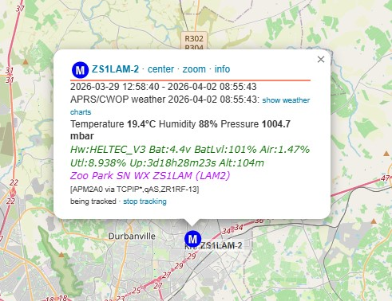

# mesh2aprs
Publish Meshtastic and MeshCore TEAM node positions to APRS‑IS



## Overview
**mesh2aprs** is a lightweight Python service that subscribes to Meshtastic and MeshCore MQTT topics and publishes position reports and telemetry to the APRS‑IS network.
This enables configured mesh nodes to appear on APRS map services such as *aprs.fi* using their assigned callsigns.

---

## Features
- 🔄 Real‑time Meshtastic → APRS‑IS position forwarding
- 📡 APRS‑IS login, filtering, and callsign mapping
- 🌍 Region‑specific Meshtastic MQTT topic support
- 🗂️ Flexible node-to-callsign configuration
- 🧩 Minimal Python dependencies and simple deployment

---

## Installation

```bash
git clone https://github.com/dadecoza/mesh2aprs.git
cd mesh2aprs
python3 -m venv venv
source venv/bin/activate
pip3 install -r requirements.txt
```

---

## Configuration

Edit the configuration file:

```bash
cp config.example.json config.json
nano config.json
```

Below is a complete example configuration file:

### Example `config.json`

```json
{
    "mqtt": {
        "host": "mqtt.meshtastic.org",
        "port": 1883,
        "username": "meshdev",
        "password": "large4cats",
        "topic": "msh/ZA/#"
    },
    "meshtastic": {
        "key": "1PG7OiApB1nwvP+rz05pAQ=="
    },
    "aprs": {
        "callsign": "N0CALL-14",
        "host": "rotate.aprs2.net",
        "port": 14580,
        "filter": "filter a/-21.0/16.45/-35.5/33.5"
    },
    "nodes": {
        "c0c31644": {
            "callsign": "N0CALL-1",
            "type": "meshtatic"
        },
        "5becd72f": {
            "callsign": "N0CALL-2",
            "type": "meshtatic"
        },
        "9e7673f0": {
            "callsign": "N0CALL-3",
            "type": "meshtatic"
        },
        "d29538f9": {
            "callsign": "N0CALL-4",
            "type": "meshtatic"
        },
        "ae5dab7415b5246c165ec5223ed0bf5399c47ea36ee9bea33ba572df4861ac20": {
            "type": "meshcore",
            "callsign": "ZR1RF-16",
            "sender_name": "ZR1RF 📟",
            "symbol": "/>"
        }
    },
    "update_interval": 10,
    "meshcore": {
        "mqtt": {
            "host": "mqtt.zr1rf.za.net",
            "port": 1883,
            "username": "meshcoreuser",
            "password": "mctomqtt",
            "topic": "meshcore/#"
        },
        "channel": "team-sar",
        "key": "REPLACE_WITH_CHANNEL_SHARED_SECRET",
        "max_message_age": 300,
        "future_tolerance": 60,
        "dedupe_seconds": 300
    }
}
```

---

## Configuration Reference

### MQTT Settings
| Field | Description |
|-------|-------------|
| `host` | MQTT broker address (public Meshtastic broker shown above) |
| `port` | MQTT port (default: 1883) |
| `username` / `password` | Optional credentials |
| `topic` | Region‑specific Meshtastic topic such as `msh/ZA/#`, `msh/EU_868/#`, `msh/US_915/#` |

---

### Meshtastic Section
| Field | Description |
|-------|-------------|
| `key` | Base64‑encoded Meshtastic decryption key used to decode MQTT frames |

---

### MeshCore Section

MeshCore uses its own broker settings under `meshcore.mqtt`; the existing top-level `mqtt` section remains for Meshtastic. The local configuration has the supplied broker credentials and `team-sar` shared secret. The example leaves the secret as a placeholder.

| Field | Description |
|-------|-------------|
| `mqtt.host` / `mqtt.port` | MeshCore broker (`mqtt.zr1rf.za.net:1883`) |
| `mqtt.username` / `mqtt.password` | Broker credentials |
| `mqtt.topic` | Subscription (`meshcore/#`) |
| `channel` | Channel name (`team-sar`) |
| `key` | 32 hex characters: the 16-byte **channel shared secret**, distinct from a radio public key |
| `max_message_age` | Maximum sender message age in seconds (default 300) |
| `future_tolerance` | Allowed clock skew into the future, seconds (default 60) |
| `dedupe_seconds` | Duplicate suppression window, seconds (default 300; at most 4096 entries) |

The initial MeshCore mapping uses radio `ZR1RF 📟`, its full public key `ae5dab7415b5246c165ec5223ed0bf5399c47ea36ee9bea33ba572df4861ac20`, and APRS callsign `ZR1RF-16`. Set each node’s `sender_name` to the exact radio name appearing before `": "` in channel messages. It defaults to the configured callsign when omitted. Sender names must be unique among configured MeshCore nodes.

The receiver supports **meshcoretomqtt/LetsMesh packet JSON** containing hex `raw` RF bytes, with optional `direction`, `SNR` and `RSSI`. It authenticates and decrypts v1 group text using the configured shared secret, then decodes TEAM beta6 `#TEL:` and `#T:` position messages and battery voltages. Packet paths may use one-, two-, or three-byte hashes and scoped transport headers. Other packet types, chat messages, status topics and TX echoes are ignored. Decoded-only MQTT JSON and direct-message telemetry are not supported.

The on-air channel hash and MAC select the channel by its secret; its name is a local label. Group text contains a sender name, **no sender public key or signature**. The node key therefore identifies the configured APRS mapping, while `sender_name` resolves incoming telemetry. This is a deliberate name mapping, not proof that a message came from that public key. The MQTT topic key and `origin_id` belong to the receiving observer and must not identify the tracker. Channel members can impersonate names.

Positions use the sender timestamp from the decrypted RF message, not the MQTT observer timestamp. Missing/zero, stale, future and retained messages are rejected. Matching messages from multiple observers/paths are deduplicated in memory; a new timestamp permits a stationary position to be reported again, subject to `update_interval`. No altitude or GPS fix time is fabricated. Companion voltage is included as `Bat:` in the APRS comment when available; the phone battery is stored separately. Database writes and APRS sends from both MQTT receiver threads are serialized.

Protocol references: [MeshCore packet format](https://github.com/meshcore-dev/MeshCore/blob/main/docs/packet_format.md), [group text payload](https://github.com/meshcore-dev/MeshCore/blob/main/docs/payloads.md#group-text-message), and [meshcoretomqtt JSON format](https://github.com/Cisien/meshcoretomqtt#example-mqtt-data). TEAM layouts were checked against `lib/models/telemetry_message.dart` and `lib/models/topology_message.dart` in the supplied MeshCore-TEAM-1.2.0-beta6 checkout.

---

### APRS Settings
| Field | Description |
|-------|-------------|
| `callsign` | Your APRS callsign with SSID (used to authenticate to APRS‑IS) |
| `host` | APRS‑IS server (use `rotate.aprs2.net` for redundancy) |
| `port` | APRS‑IS port (typically 14580) |
| `filter` | APRS‑IS filter to limit inbound traffic (typically a bounding box) |

Example southern Africa filter:
```
filter a/-21.0/16.45/-35.5/33.5
```

---

### Node Mapping
Each node ID is mapped to an APRS callsign and transport:

```json
"nodes": {
    "c0c31644": { "type": "meshtatic", "callsign": "N0CALL-1", "symbol": "/>" }
}
```

- **Key** — Meshtastic eight-character node ID, or preferably the full 64-character MeshCore radio public key. MeshCore also accepts explicit even-length key prefixes of 8–64 hex characters; keys are never silently shortened.
- **Value**
  - `type`: `"meshtatic"` or `"meshcore"`. The correctly spelled `"meshtastic"` is also accepted; omitted types retain Meshtastic behavior.
  - APRS callsign
  - APRS Symbol (https://www.aprs.org/symbols/symbols-new.txt)

Only listed nodes will be published.

---

### Update Interval

Sets how often each node is transmitted in seconds:

```
"update_interval": 10
```

---

## Running the Script

```bash
python3 main.py
```

---

## Notes
- You must have a valid APRS callsign + SSID to send to APRS‑IS.
- Meshtastic nodes must output valid GPS data.
- The APRS filter should cover your expected operating region.
- Using `rotate.aprs2.net` ensures automatic APRS‑IS load balancing.

---

## Testing

```bash
python3 -m unittest discover -s tests -v
```

Tests cover TEAM vectors, malformed packets, channel authentication, routing, sender mapping, freshness, deduplication, APRS output, startup/shutdown and Meshtastic compatibility. A local MQTT socket fixture exercises real Paho delivery through the real APRS socket writer without publishing to an external service. Importing `main` does not open network connections.

---

## License
MIT License

---

## Contributions
Pull requests are welcome! If you have improvements, open an issue or PR.
